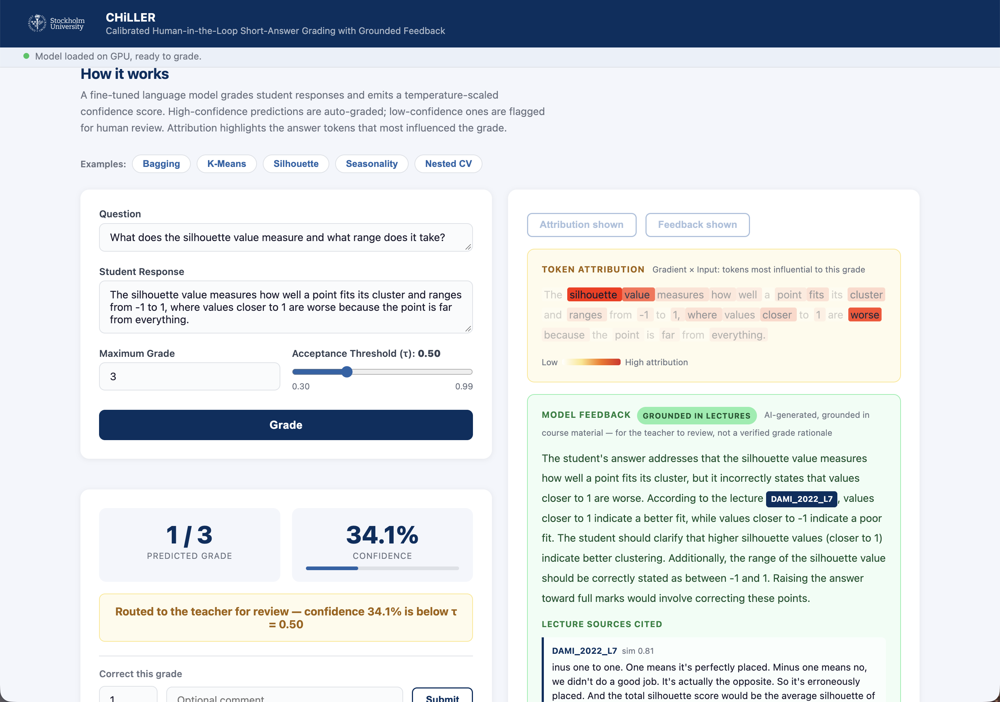

# CHiLLER: Calibrated Human-in-the-Loop Short-Answer Grading with Grounded Feedback

**CHiLLER** is an on-premise, **human-in-the-loop** short-answer grading system built on **open-weight
LLMs**. It combines calibrated **confidence-based routing** — selectively deferring uncertain predictions
to the teacher — with gradient-based **token attribution** and **retrieval-grounded feedback** from course
materials. Teachers can inspect predictions, adjust grades, and record corrections for later model
adaptation. Because it runs entirely on local hardware, student answers never leave the institution.

This repository is the interactive grading server (FastAPI + a browser UI) demonstrated in our WSDM '27
paper; the full training, adaptation, and calibration pipeline is described there. It is a **research
prototype**, not a production grading service.



## How it works

CHiLLER follows a human-in-the-loop workflow with four components, plus a correction loop.

**1 · Calibrated grading.** The grader never *generates* a grade. For each admissible grade `y ∈ {0..G}`
it scores the structured response `{"grade": y, "max_grade": G}` and takes its log-likelihood `ℓ(y|x)`.
Treating these as logits, temperature scaling yields a distribution `p_T(y|x)`; the predicted grade is
`ŷ = argmax_y p_T(y|x)` and the confidence is `c(x) = max_y p_T(y|x)`. The temperature `T` is fit on a
teacher-graded validation split by minimizing expected calibration error — it calibrates the confidence
**without changing `ŷ`**.

**2 · Confidence-based routing.** Given a threshold `τ` (default **0.50**), an answer with `c(x) ≥ τ` is
accepted automatically; otherwise it is **routed to the teacher**. Because scoring already yields both `ŷ`
and `c(x)`, routing adds **no extra inference cost** — unlike confidence from repeated sampling or
self-explanations.

**3 · Token attribution.** To show which words most influenced a grade, CHiLLER computes **Gradient×Input**
with respect to `ℓ(ŷ|x)`: for each token, the element-wise product of its input embedding and gradient,
aggregated by the L2 norm over the embedding dimension — a non-negative importance score from a single
backward pass. Sub-word scores are averaged into words; stop-words and punctuation are dropped for display.
This requires access to the model weights, which closed APIs do not provide.

**4 · Retrieval-grounded feedback.** The retrieval index holds lecture material — one chunk per slide, with
transcripts split into ~700-character segments — embedded with Sentence-BERT, unit-normalized, in a FAISS
index. The question and answer form the query, and the most similar chunks are retrieved (reserving slots
for both slides and transcripts). A separate, larger model (Qwen2.5-14B-Instruct) writes the feedback:
first acknowledging what the answer covers, then naming the concepts missing for full marks, citing the
slide/transcript sources. If the top similarity falls below `θ` (default **0.35**), feedback is generated
without retrieved context and marked **uncited**. Feedback can be requested for any answer and is reviewed
by the teacher before release to students.

**Corrections.** When a teacher corrects a grade, the predicted grade, the corrected grade, and an optional
comment are written to a correction pool that serves as training data for subsequent adapters.

In our evaluation on 180 held-out answers, at `τ = 0.50` the system routes **16.1%** of answers to the
teacher while capturing **75% (9/12)** of the large grading errors (deviations of ≥ 2 marks) — review
effort concentrates on the answers the grader is least sure about. See the paper for the full tables.

## Ingredients

- A CUDA GPU (~16 GB is enough for the 7B grader in bf16; a second GPU is optional, for the 14B feedback model).
- Python 3.10+ and PyTorch (install the build matching your CUDA).
- A **LoRA adapter** for the grader (see *Providing a model* below).
- *(Optional)* A **reference corpus** for grounded feedback (`chunks.faiss_index` + `chunks.json`).

## Recipe

```bash
# 1. Install
pip install -r requirements.txt          # add requirements-dev.txt to run the tests

# 2. Put a LoRA adapter at ./adapter  (or set ADAPTER_DIR=/path/to/adapter)
#    The base model (Qwen/Qwen2.5-7B-Instruct) downloads from the Hugging Face Hub automatically.

# 3. (Optional) Put a reference corpus at ./rag  (chunks.faiss_index + chunks.json)
#    No corpus? Run with USE_RAG=0 and feedback is simply ungrounded.

# 4. Run
uvicorn main:app --host 127.0.0.1 --port 8080

# 5. Open http://127.0.0.1:8080  — click an example, press Grade, then View Attribution / Get Feedback.
```

The model loads on the first request (the first call takes a moment) and offloads after `IDLE_TIMEOUT`
seconds of inactivity.

### With Docker

```bash
docker build -t chiller .
docker run -d --gpus all -p 127.0.0.1:8080:8080 \
  -v /path/to/adapter:/app/adapter:ro \
  -v /path/to/rag:/app/rag:ro \
  chiller
```

## Providing a model

`BASE_MODEL` is pulled from the Hugging Face Hub; `ADAPTER_DIR` must point at a **LoRA adapter** that
fine-tunes the base model to score the grade candidates well. As in the paper, such an adapter is trained
on graded answers and further adapted to a teacher-graded seed batch of the target examination. Train your
own, or use a released adapter. *(Adapter + corpus download: TBD.)*

## Configuration

All settings are environment variables with sensible defaults:

| Variable | Default | Meaning |
|---|---|---|
| `BASE_MODEL` | `Qwen/Qwen2.5-7B-Instruct` | Grader base model (Hugging Face Hub) |
| `ADAPTER_DIR` | `adapter` | LoRA adapter directory |
| `RAG_DIR` | `rag` | Reference corpus (`chunks.faiss_index` + `chunks.json`) |
| `USE_RAG` | `1` | Set `0` to disable retrieval (feedback stays ungrounded) |
| `RAG_TOP_K` | `5` | Number of chunks retrieved per query |
| `RAG_MIN_SCORE` | `0.35` | `θ`: abstain (generate uncited feedback) below this cosine similarity |
| `FEEDBACK_MODEL` | *(empty)* | Optional larger model for feedback (see below) |
| `IDLE_TIMEOUT` | `300` | Seconds of inactivity before the model offloads |
| `GRADER_GPU` / `FEEDBACK_GPU` | `0` / `1` | Pinned GPU indices |

The routing threshold `τ` (default `0.50`) is a per-request parameter and is adjustable live in the
interface.

### Better feedback (optional, needs a 2nd GPU)

By default feedback is written by the grader's own base model (adapter disabled) — simple, one GPU. For
more faithful prose, set e.g. `FEEDBACK_MODEL=Qwen/Qwen2.5-14B-Instruct`; it loads in 8-bit in a separate
process on `FEEDBACK_GPU` and is killed on idle to free its memory. Separating grading from feedback was a
deliberate design choice: the fine-tuned grader predicts grades well but its own feedback was often
unreliable, so a dedicated model, grounded in retrieved material, generates it instead.

## API

| Route | Does |
|---|---|
| `POST /grade` | `{question, response, max_grade, temperature, tau}` → grade, confidence, accepted |
| `POST /attribution` | token salience for the predicted grade |
| `POST /feedback` | grounded, cited feedback (abstains when ungrounded) |
| `POST /correct` | log a teacher correction |
| `GET /`, `/health`, `/status` | UI, health, runtime status |

## Tests

```bash
pip install -r requirements-dev.txt
pytest test_main.py        # fully mocked, no GPU required
```

## Notes & limitations

- **Research prototype**, not a production grader — keep a human in the loop.
- Feedback is **grounded, cited, and abstaining — not a verified rationale.** It can be wrong, especially
  on multi-step quantitative answers; it exists to help the teacher decide, not to replace them.
- **High confidence is not a guarantee of correctness.** An insufficiently adapted grader can be
  confidently wrong (including under prompt injection), which is exactly why routing is paired with teacher
  oversight rather than treated as a correctness guarantee.
- **Calibration is course-dependent.** A temperature fit on earlier course editions was overconfident on a
  new examination; adapt and recalibrate on representative teacher-graded answers.
- Attribution is most informative on the *uncertain* answers — a very confident grade saturates to a flat
  map, which is fine, since those are the answers the human does not need to inspect.
- The base model and any adapter carry their **own licenses** (e.g. the Qwen license); comply with them.

## License

Released under the **Apache License 2.0** — see [LICENSE](LICENSE). Note that the base model and any
adapter you use carry their **own licenses** (e.g. the Qwen license); comply with those separately.
